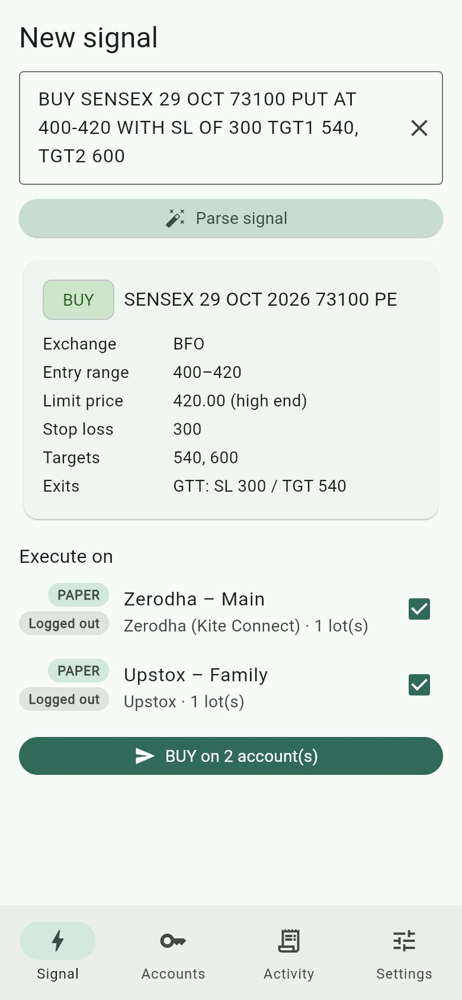
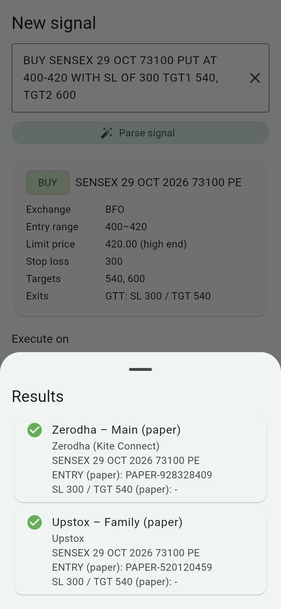
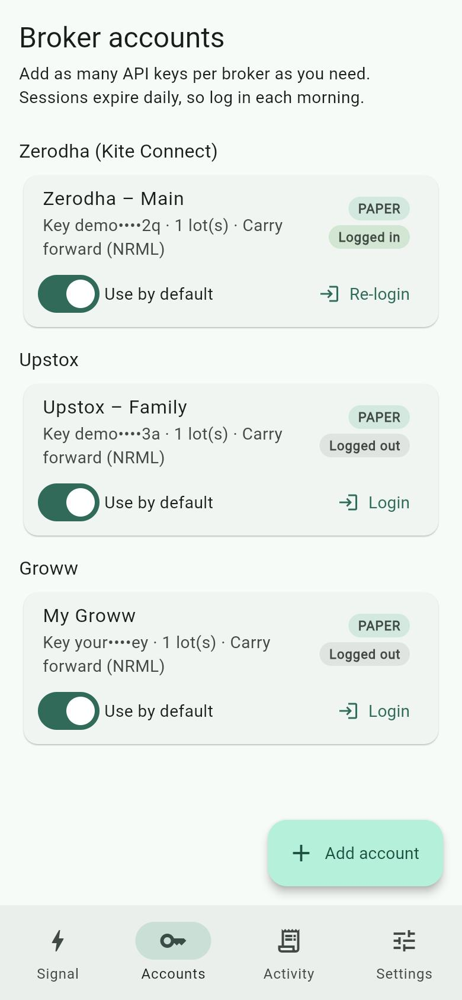
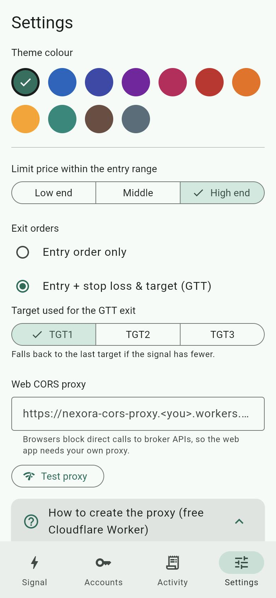
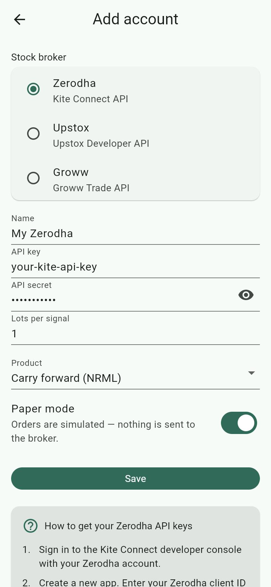
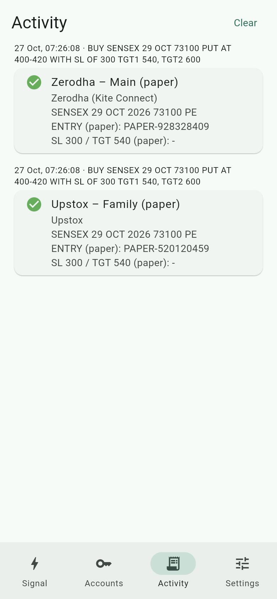
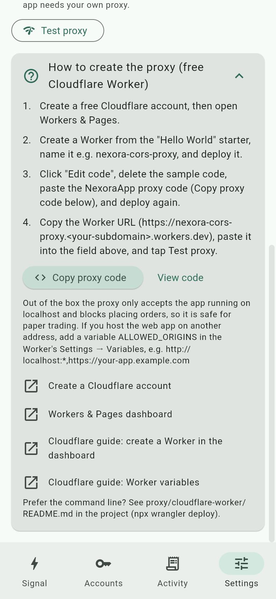

# NexoraApp

[](https://github.com/palepujanakiram/nexora-app/actions/workflows/ci.yml)

Flutter app (iOS, Android, web) that turns option signals like

```
BUY SENSEX 29 OCT 73100 PUT AT 400-420 WITH SL OF 300 TGT1 540, TGT2 600
```

into orders on any number of **Zerodha (Kite Connect)**, **Upstox** and **Groww** accounts.

<p align="center">
  
  
  
  
</p>

## Features

- **Many accounts, three brokers:** add any number of API keys per broker and pick which accounts each signal runs on.
- **Signal parsing:** paste a signal in plain text; the app shows exactly what it understood before anything is sent.
- **Paper mode by default:** new accounts simulate orders. When logged in, paper trades still look up the real contract and lot size.
- **Live orders with a confirmation:** a LIMIT entry and, for Zerodha and Upstox, a stop loss and target managed by the broker (GTT).
- **Activity log** of every execution, with order IDs or errors.
- **Secure key storage** (Keychain on iOS, Keystore-encrypted on Android).
- **Settings:** theme colour, entry price within the range, exit orders, target choice, and a web CORS proxy with a built-in setup guide and health check.

## Supported brokers

| | Zerodha (Kite Connect) | Upstox | Groww |
|---|---|---|---|
| **Daily login** | Kite login page → paste the redirect URL (`request_token`) | Upstox login page → paste the redirect URL (`code`) | Approve the key on Groww's API keys page → **Generate session** (or a TOTP code) |
| **Session expires** | 06:00 IST | 03:30 IST | 06:00 IST |
| **Contract lookup** | Kite instrument list (NFO/BFO) | Option-contract API (indices only) | Groww's public instrument list (NSE/BSE F&O) |
| **Entry order** | LIMIT (`/orders/regular`) | LIMIT (HFT `/v3/order/place`); with exits on, the entry is a leg of the GTT | LIMIT (`/v1/order/create`) |
| **Stop loss + target** | Two-leg GTT (OCO) | One GTT `MULTIPLE` order (entry + target + SL) | Not placed: add an OCO in the Groww app after the entry fills |
| **API plan** | Paid **Connect** plan (needs market data) | Upstox developer app (see the guide) | Trading APIs subscription |
| **Step-by-step guide** | [Zerodha guide](docs/zerodha-guide.md) | [Upstox guide](docs/upstox-guide.md) | [Groww guide](docs/groww-guide.md) |

Products map to NRML (carry forward) or MIS (intraday) on Zerodha and Groww, and to D or I on Upstox.

## How it works

The app has four tabs: **Signal**, **Accounts**, **Activity** and **Settings**. Screenshots are from the web build with demo accounts in paper mode.

### 1. Add your broker accounts

| | |
|---|---|
|  | **Accounts → Add account.** Pick the stock broker with the radio buttons (Zerodha, Upstox or Groww); the fields change to match it (Upstox also needs the redirect URI from your Upstox app).<br><br>For each account set the **lots per signal**, the **product** (carry forward or intraday) and **Paper mode**. Paper mode is on by default: the app simulates the orders and sends nothing to the broker.<br><br>Below the form, **How to get your … API keys** lists the steps and links to the broker's developer site and docs. |
|  | Accounts are grouped by broker, and you can add as many keys per broker as you need. Each card shows the masked key, lots, product, **PAPER** / **LIVE** and whether today's session is active.<br><br>**Use by default** decides whether the account is ticked on the Signal screen.<br><br>**Login** (daily):<ul><li>**Zerodha / Upstox:** **Open login page**, sign in, then paste back the URL you land on; the app exchanges the `request_token` (Kite) or `code` (Upstox) for an access token.</li><li>**Groww:** **Open API keys page**, approve today's access, then tap **Generate session** (or enter a TOTP code first).</li><li>Any broker: paste an access token and tap **It is an access token**.</li></ul> |

### 2. Paste a signal and execute it

| | |
|---|---|
|  | **Signal tab.** Paste the signal and tap **Parse signal**. The card shows what was understood: side, contract (`SENSEX 29 OCT 2026 73100 PE`), exchange (BFO for SENSEX/BANKEX/SENSEX50, otherwise NFO), entry range, the limit price that will be used, stop loss, targets and the exit orders. Warnings (e.g. a stop loss on the wrong side of the entry) are shown on the card.<br><br>Tick the accounts to use and tap **BUY on N account(s)**. The app asks **Run paper trade?** or, if any ticked account is live, **Place LIVE orders?** with the number of accounts that will send real orders. |
|  | The orders go to all selected accounts in parallel. For each account the app:<ul><li>looks up the exact option contract and lot size from the broker (when logged in),</li><li>places a LIMIT entry for `lots × lot size` at the chosen end of the entry range,</li><li>optionally places the stop loss and target on the broker's side (see [Supported brokers](#supported-brokers)).</li></ul>Results show the order IDs, or the error, per account. Paper trades show `PAPER-…` IDs. A live account must be logged in today; a paper account works logged out too (it then skips the contract lookup). |

### 3. Review activity

| | |
|---|---|
|  | **Activity tab.** Every execution is kept with the time, the original signal, the contract, and the order IDs or error (the last 200, stored on the device). **Clear** empties it. |

### 4. Settings

| | |
|---|---|
|  | <ul><li>**Theme colour**: eleven colours, saved on the device.</li><li>**Limit price within the entry range**: low end, middle or high end (for `AT 400-420`: 400, 410 or 420).</li><li>**Exit orders**: entry only, or entry + stop loss & target (GTT). Groww always places the entry only.</li><li>**Target used for the GTT exit**: TGT1–TGT3; falls back to the last target if the signal has fewer.</li><li>**Web CORS proxy** (web only, see below).</li></ul> |
|  | **Web only.** Browsers block direct calls to the broker APIs, so the web build needs your own proxy. **How to create the proxy** walks you through a free Cloudflare Worker in four steps: **Copy proxy code** copies the worker (or **View code** shows it to select by hand), and the links open Cloudflare's dashboard and docs.<br><br>**Test proxy** checks the URL and tells you whether it's connected, rejecting this app's address, not the NexoraApp proxy, or unreachable. |

## Signal format

```
<BUY|SELL> <SYMBOL> <DD> <MON> [YYYY] <STRIKE> <CE|PE|CALL|PUT> <entry> [SL <price>] [TGT <price>, <price>, …]
```

| Part | Accepted forms | Examples |
|---|---|---|
| Side and symbol | `BUY` / `SELL`, then the underlying | `BUY NIFTY`, `SELL BANKNIFTY` |
| Expiry | Day and month name, optional year. Without a year, the next occurrence (today included) is used. | `29 OCT`, `30-OCT-2026`, `3RD NOV` |
| Strike and type | Number, then `CE`/`CALL` or `PE`/`PUT` | `24500 CE`, `73100 PUT` |
| Entry | A price or a range, optionally after `AT`, `@`, `ABOVE`, `NEAR`, `AROUND`, `BETWEEN`, `RANGE` or `CMP`; ranges use `-`, `TO`, `/` or `AND` | `AT 400-420`, `@ 120 TO 125`, `ABOVE 95` |
| Stop loss | `SL`, `STOP LOSS` or `STOPLOSS`, optionally followed by `OF`, `IS`, `AT`, `:` | `WITH SL OF 300`, `SL 160` |
| Targets | `TGT`, `TARGET(S)` or `TP`, numbered or as a list | `TGT1 540, TGT2 600`, `TARGET 90/70` |

Case and extra spaces don't matter. If the side, symbol, expiry, strike, type or entry can't be found, the app shows an error instead of a plan.

## How account keys are stored

API keys, secrets and access tokens are stored only through `flutter_secure_storage`, never in plain preferences:

- **iOS**: Keychain, readable only while the device is unlocked, not synced to iCloud and not restored to another device.
- **Android**: AES-GCM encrypted with a hardware-backed Android Keystore key. Auto Backup is turned off so the encrypted values are never restored onto a device that doesn't have the key.
- **Web**: encrypted with WebCrypto, but the key lives in the same browser profile. Treat web as convenience only and prefer the mobile apps for live trading accounts.

Settings and the activity log are kept in `shared_preferences`.

## Getting started

Requires **Flutter 3.44** (Dart 3.12) or later; CI uses Flutter 3.44.3.

```bash
flutter pub get
flutter run                   # pick a connected device, simulator or Chrome
```

Builds:

```bash
flutter build apk             # Android (applicationId com.janakiram.nexora_app)
flutter build ios             # iOS (bundle ID com.srisarani.nexora, team WR859F2ZHY; needs Xcode and signing)
flutter build web             # web, served from build/web (needs the CORS proxy below)
```

**TestFlight:** `cd ios && bundle exec fastlane beta` runs the checks, builds, signs and uploads the iOS app. One-time setup (App Store Connect app record and API key) is in [docs/testflight.md](docs/testflight.md).

**Web needs a CORS proxy.** Browsers block direct calls to `api.kite.trade`, `api.upstox.com` and `api.groww.in`. Put your own proxy URL in **Settings → Web CORS proxy**; it's prepended to every API URL. iOS and Android don't need one. A ready-made Cloudflare Worker for testing (orders blocked by default) is in [proxy/cloudflare-worker](proxy/cloudflare-worker/README.md), and the app has a step-by-step guide for it under Settings.

## Testing with the real broker APIs

Step-by-step guides for each broker, written for non-programmers and with screenshots:

- **[Zerodha (Kite Connect) guide](docs/zerodha-guide.md)**
- **[Upstox guide](docs/upstox-guide.md)**
- **[Groww guide](docs/groww-guide.md)**

Each guide goes through the same six parts:

| Part | What you do | Sends real orders? |
|---|---|---|
| 1. Get ready | F&O enabled on your broker account, NexoraApp on your phone | No |
| 2. Create the broker's API app or key | Get an API key and secret from the broker's developer site | No |
| 3. Add the account in NexoraApp | Enter the key and secret; **Paper mode** stays on | No |
| 4. Log in (every trading day) | Zerodha/Upstox: **Login → Open login page**, sign in, paste the address you land on, **Generate session**. Groww: approve the key on its API keys page, then **Generate session**. | No |
| 5. Paper trade | Run a signal for a real contract: the app looks up the real contract and lot size but places nothing | No |
| 6. Live trade | Register a static IP, turn **Paper mode** off, confirm **Place LIVE orders?**, then check the order in the broker's app | **Yes** |

Key points before going live:

- **Use the phone app.** The web version can log in and paper trade, but it can't place orders: browsers need the CORS proxy, which blocks orders, and Cloudflare's addresses aren't static.
- **A static IP is required for API orders** under SEBI's rules (Zerodha has enforced it since 1 April 2025, Upstox since 1 April 2026; check Groww's requirement on its API keys page). Get one from your broadband provider or a VPN with a dedicated IP, and register it on the broker's developer site.
- **Zerodha:** choose the paid **Connect** plan (₹500/month). The free Personal plan has no market data, which the app needs to find contracts.
- **Upstox:** only index options are supported for now (NIFTY, BANKNIFTY, FINNIFTY, MIDCPNIFTY, SENSEX, BANKEX).
- **Groww:** needs a Trading APIs subscription. NexoraApp places the entry only; add the stop loss and target in the Groww app after it fills.
- The live order code follows each broker's published documentation but hasn't yet been run against a real account. Start with 1 lot, and cancel or exit trades in the broker's own app; NexoraApp only places orders.

## Project structure (Clean Architecture)

```
lib/
  main.dart                 init dependencies, runApp
  app.dart                  MaterialApp; rebuilds theme from the saved theme colour
  common/                   code shared by every screen
    di/injector.dart        get_it wiring: data sources → repositories → use cases
    domain/                 pure Dart, no Flutter or HTTP
      entities/             TradeSignal, BrokerAccount, AppSettings, TradePlan, ExecutionResult, ProxyHealth
      repositories/         abstract interfaces (accounts, settings, activity, broker, proxy)
      services/             SignalParser, TradePricing
      usecases/             shared use cases (watch accounts, watch settings)
    data/
      models/               JSON mappers for entities
      datasources/local/    secure storage (keys/tokens), shared preferences
      datasources/remote/   Zerodha (Kite Connect), Upstox and Groww APIs, shared HTTP helpers
      repositories/         repository implementations (in-memory cache + change stream; broker routing; proxy check)
    presentation/           shared widgets and theme
    error/  utils/
  screens/<screen>/         signal, accounts, account_edit, activity, settings, home
    view/                   widgets only; reads state from the view model
    viewmodel/              ChangeNotifier; calls use cases, exposes state
    model/                  the screen's UI state / form model
    usecase/                operations this screen performs
```

Dependencies point inward: views → view models → use cases → repository interfaces ← data layer.

Rest of the repository:

```
test/                       tests mirroring lib/ (fakes in test/fakes.dart)
tool/coverage.dart          runs the tests with the 95% coverage gate
proxy/cloudflare-worker/    CORS proxy for the web build (Cloudflare Worker + tests)
docs/                       broker guides and screenshots
.github/workflows/ci.yml    CI: analyze, Flutter and worker coverage gates, qlty upload
.qlty/qlty.toml             qlty code-quality configuration
CLAUDE.md                   project conventions, including the mandatory test coverage rule
```

## Tests and coverage

Every change needs tests, and line coverage of `lib/` must stay at or above **95%** (see [CLAUDE.md](CLAUDE.md)). Currently 333 Flutter tests at 99.86% line coverage, and 11 worker tests at 100%.

```bash
flutter analyze                                  # must report no issues
dart run tool/coverage.dart                      # all tests + 95% gate; lists files below 95%
cd proxy/cloudflare-worker && npm run coverage   # worker tests + 95% gate
```

`tool/coverage.dart` counts every file under `lib/`, including files no test imports, so untested code can't hide. Broker APIs are tested against mocked HTTP responses; tests never call real brokers. The [CI workflow](.github/workflows/ci.yml) runs all three checks on every pull request and push to `main`, and uploads the Flutter coverage to qlty.

## Notes and limits

- **Verify with paper mode and one lot first.** The broker API calls follow the published docs but haven't been run against live accounts.
- **NexoraApp only places orders.** Cancel orders, change GTTs and exit positions in the broker's own app.
- **Upstox** contract lookup currently covers indices only (NIFTY, BANKNIFTY, FINNIFTY, MIDCPNIFTY, SENSEX, BANKEX).
- **Groww**: entry orders only (no stop loss/target), and login needs the API key approved on Groww's API keys page each day.
- The Kite GTT stop-loss leg uses a limit price 5% past the trigger so it still fills on a fast move.
- **Regulation:** SEBI's retail algo-trading framework applies to API orders (static IP whitelisting, order-rate limits, broker registration of algos). Check what your brokers require before running this live.
