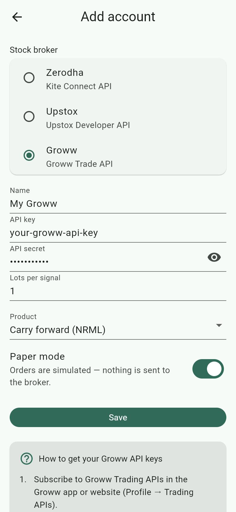
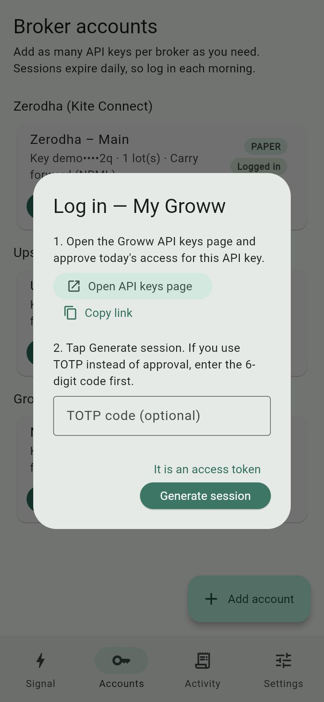

# Using NexoraApp with Groww

This guide takes you from nothing to a paper trade, and then to a real (live) order, using your Groww account. No programming knowledge is needed. Follow the parts in order.

| Part | What you do | Sends real orders? |
|---|---|---|
| [1. Get ready](#part-1-get-ready) | Check your Groww account and phone | No |
| [2. Get your Groww API key](#part-2-get-your-groww-api-key) | Subscribe to Trading APIs and create a key and secret | No |
| [3. Add the account in NexoraApp](#part-3-add-the-account-in-nexoraapp) | Type the key and secret into the app | No |
| [4. Log in (every trading day)](#part-4-log-in-every-trading-day) | Approve the key on Groww, then start the session in the app | No |
| [5. Paper trade](#part-5-paper-trade) | Practise with a real signal; nothing is bought | No |
| [6. Live trade](#part-6-live-trade) | Place a real order | **Yes** |

> **Words used in this guide**
> - **API key / API secret**: a username and password that let NexoraApp talk to Groww for you. Groww gives them to you in Part 2. Never share the secret.
> - **Approval**: each trading day you approve your API key on Groww's website. Until you do, NexoraApp can't log in.
> - **TOTP**: a 6-digit code from an authenticator app. Groww lets you use it instead of the daily approval.
> - **Paper mode**: practice mode. NexoraApp shows what it *would* order but sends nothing to Groww.
> - **Live mode**: NexoraApp places real orders with real money.
> - **OCO (One Cancels the Other)**: a stop loss and target pair at Groww; when one fires, the other is cancelled.

> **Important difference from Zerodha and Upstox:** with Groww, NexoraApp places **only the entry order**. Groww's API accepts a stop loss / target (OCO) only once you already hold the position, so NexoraApp can't send it together with the entry. After the entry fills, add the stop loss and target yourself in the Groww app (Part 6.7). The result in NexoraApp reminds you: *"SL … / TGT …: not placed: add an OCO in the Groww app after the entry fills"*.

---

## Part 1: Get ready

You need:

1. **A Groww account with F&O (futures and options) enabled.** Signals in NexoraApp are option trades. You can activate F&O from your profile in the Groww app.
2. **NexoraApp on your Android phone or iPhone.** The phone app is recommended. The web version can only log in and practise, because browsers can't place orders with Groww directly.
3. **A Groww Trading APIs subscription.** Groww's API needs an active subscription; Part 2 shows where to buy it. Check the current price on that page.

---

## Part 2: Get your Groww API key

You only do this once.

1. **Subscribe:** open **[groww.in/user/profile/trading-apis](https://groww.in/user/profile/trading-apis)** (Groww website → Profile → **Trading APIs**), log in, and buy the Trading APIs subscription.
2. **Create a key:** open **[groww.in/trade-api/api-keys](https://groww.in/trade-api/api-keys)** and choose **Generate API keys**. Give the key a name, e.g. `NexoraApp`.
3. Copy the **API key** and the **API secret** that Groww shows. Keep this page open for Part 3.

Groww offers two kinds of keys on that page:

| Kind | How it logs in each day | Use it with NexoraApp? |
|---|---|---|
| **API key + secret (approval)** | You tap approve on the API keys page each day | **Yes, recommended.** |
| **API key + TOTP** | You enter a 6-digit code from an authenticator app | Yes: type the code in the login box (Part 4). |

You don't need a redirect URL with Groww.

> Keep the API secret private. Anyone with your key and secret could act on your account once the key is approved for the day. If you think it leaked, delete the key on the API keys page and create a new one.

---

## Part 3: Add the account in NexoraApp

1. Open NexoraApp and go to the **Accounts** tab.
2. Tap **Add account**.
3. Under **Stock broker**, choose **Groww**.
4. Fill in the form:

   | Field | What to enter |
   |---|---|
   | **Name** | A label for you, e.g. `My Groww` |
   | **API key** | The API key from Part 2 |
   | **API secret** | The API secret from Part 2 (tap the eye icon to check it) |
   | **Lots per signal** | `1` while testing. The app buys this many lots per signal. |
   | **Product** | **Carry forward (NRML)** to hold overnight, or **Intraday (MIS)** to square off the same day |
   | **Paper mode** | **On**, and keep it on until Part 6 |

5. Tap **Save**.



The bottom of this screen shows **How to get your Groww API keys**, with the same steps and links.

NexoraApp stores the key and secret in your phone's secure storage (Keychain on iPhone, encrypted Keystore storage on Android). They're never sent anywhere except Groww.

---

## Part 4: Log in (every trading day)

Groww sessions end every morning at about **6:00 AM IST**, so do this once each trading day before you use the app.

1. On the **Accounts** tab, find your Groww card and tap **Login**.
2. Tap **Open API keys page**. Your browser opens Groww's API keys page; log in to Groww if asked.

   

3. Find your key and **approve** it for today.
4. Switch back to NexoraApp and tap **Generate session**, leaving the box **empty**.
   - Using a TOTP key instead? Type the current **6-digit code** from your authenticator app into the box first, then tap **Generate session**.
5. The card should now say **Logged in**, and the button changes to **Re-login**.

   

   (This screenshot shows a Zerodha card; a Groww card looks the same.)

**Alternative:** on the API keys page you can also generate an **Access Token** yourself. Copy it, paste it into the box, and tap **It is an access token**.

**If it fails:** check you approved the right key *today*, that the secret in NexoraApp is correct, and that your phone's clock is set automatically (Groww rejects requests whose time is more than 10 minutes off).

---

## Part 5: Paper trade

Paper mode lets you check everything with real Groww data while nothing is bought or sold. NexoraApp downloads Groww's list of contracts, finds the exact option (so you can see it picked the right one), then stops before placing the order.

### 5.1 Pick a signal for a contract that exists

The signal must name an expiry date and strike that Groww actually lists. To check:

1. In the Groww app, open the index (e.g. **NIFTY**) and its **option chain**.
2. Pick an upcoming expiry (for example `3 NOV`) and a strike shown in the chain (e.g. `24500`).
3. Use the same index, expiry, strike and CE/PE in your signal. Example:

   ```
   BUY NIFTY 3 NOV 24500 CE AT 100-110 WITH SL OF 80 TGT1 140, TGT2 160
   ```

   SENSEX and BANKEX options are looked up on BSE, all others on NSE. The app picks the exchange for you.

### 5.2 Run it

1. Go to the **Signal** tab, paste the signal and tap **Parse signal**.
2. Check the card: **BUY/SELL**, contract, **Entry range**, **Limit price**, **Stop loss**, **Targets** and **Exits**.
3. Under **Execute on**, tick your Groww account. It should show **PAPER** and **Logged in**.
4. Tap **BUY on 1 account(s)**. The app asks **Run paper trade?**. Tap **Run**.

   

### 5.3 Check the result

A results sheet opens (it's also saved in the **Activity** tab). For your Groww account, check:

- ✅ a green tick and **(paper)** after the account name;
- the **contract** is Groww's trading symbol (e.g. `NIFTY26N0324500CE`), not just the signal text;
- the **quantity** is your lots × Groww's lot size for that index;
- **ENTRY (paper): PAPER-…**.


The screenshot above was taken while logged out, so it shows the signal text instead of the broker's symbol.

A red ❗ with a message means something needs fixing; see [Troubleshooting](#troubleshooting).

---

## Part 6: Live trade

> ⚠️ **Live mode places real orders with real money.** Losses are possible. NexoraApp's Groww order code follows Groww's published documentation but hasn't yet been run against a real account, so start with **1 lot** and keep the Groww app open alongside.

### 6.1 Static IP

SEBI's rules for retail API trading (in force since April 2026) require API orders to come from a **static IP** registered with your broker. Zerodha and Upstox enforce this. Groww's API documentation doesn't describe its static IP setup, so check the API keys page or ask Groww support whether you need to register one. If you do:

- Get a static IP from your home broadband provider (ask for a "static public IP"), or use a VPN with a dedicated IP.
- Check the IP your phone uses at **[api.ipify.org](https://api.ipify.org)** and register that address with Groww.

### 6.2 Make sure the account can trade

- Enough **funds** in Groww for 1 lot at the limit price.
- F&O enabled (Part 1).
- Logged in today (Part 4).

### 6.3 Switch the account to live

1. **Accounts** → tap your Groww card.
2. Check **Lots per signal** is `1` and **Product** is what you want.
3. Turn **Paper mode** off. The text changes to *"LIVE: orders will be placed with real money."* Tap **Save**. The card now shows a red **LIVE** badge.

   

### 6.4 Check Settings

On the **Settings** tab, **Limit price within the entry range** decides the entry price: for `AT 100-110`, **Low end** = 100, **Middle** = 105, **High end** = 110. The **Exit orders** settings don't apply to Groww, because exits aren't placed (see the note at the top).

### 6.5 Place the order

1. **Signal** tab → paste the signal → **Parse signal** → check the card.
2. Tick **only** your live Groww account.
3. Tap **BUY on 1 account(s)**. The app asks **Place LIVE orders?** and says how many accounts will send real orders. Read it carefully, then tap **Place orders**, or **Cancel** to stop.

   

### 6.6 Check it in Groww

Open the Groww app → **Orders** (F&O). You should see a **LIMIT** buy order for your contract at the limit price, open until the price reaches it. NexoraApp shows Groww's order ID in the result and in the **Activity** tab.

### 6.7 Add the stop loss and target

Once the entry order has **filled** (you hold the position), set the stop loss and target in the Groww app on that position, for example with a **stop loss / target (OCO)** order. NexoraApp doesn't do this for Groww.

To cancel an unfilled entry or exit a position, use the Groww app. To go back to practice, edit the account and turn **Paper mode** on again.

---

## Daily checklist

1. Groww → API keys page → approve your key.
2. NexoraApp → **Accounts** → **Login** / **Re-login** → **Generate session**.
3. **Signal** → paste → **Parse signal** → check → tick accounts → confirm.
4. In Groww, check the order; once filled, add your stop loss and target.

---

## Troubleshooting

| What you see | What it means / what to do |
|---|---|
| *Session expired — log in to … first* | You haven't logged in today. Do Part 4. |
| Error after **Generate session** | Today's approval is missing, the secret is wrong, or your phone's clock is off. Approve the key again, check the secret, and set the phone's time to automatic. |
| *Groww: leave the box empty, or enter the 6-digit TOTP code.* | You pasted something else into the login box. Clear it, or enter only the 6 digits. |
| *Groww instruments download failed (…)* | Groww's contract list couldn't be downloaded. Check your internet connection and try again. |
| *No Groww contract found for …* | That expiry or strike isn't listed. Check the option chain (Part 5.1) and fix the signal. |
| *SL … / TGT …: not placed: add an OCO in the Groww app after the entry fills* | Expected: Groww exits aren't placed by NexoraApp. Add them in the Groww app. |
| Order rejected for **margin/funds** | Not enough money in Groww for the order. Add funds or reduce lots. |
| Web app: *Order placement is disabled on this proxy* | Expected. The web version can't place orders. Use the phone app. |

More help: [Groww Trade API documentation](https://groww.in/trade-api/docs/curl).
