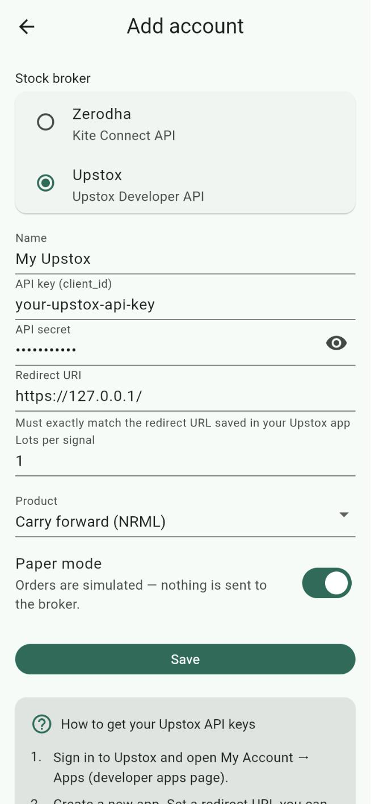
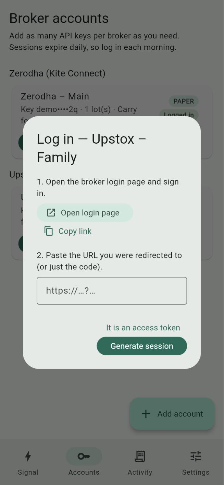
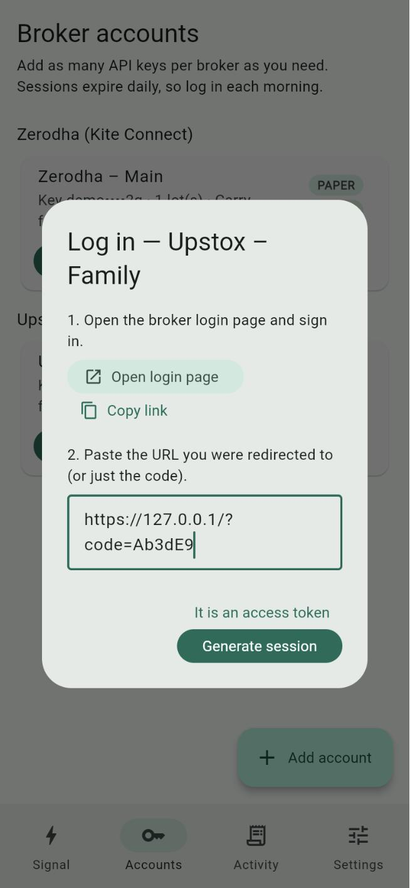

# Using NexoraApp with Upstox

This guide takes you from nothing to a paper trade, and then to a real (live) order, using your Upstox account. No programming knowledge is needed. Follow the parts in order.

| Part | What you do | Sends real orders? |
|---|---|---|
| [1. Get ready](#part-1-get-ready) | Check your Upstox account and phone | No |
| [2. Create your Upstox API app](#part-2-create-your-upstox-api-app) | Get an API key and secret from Upstox | No |
| [3. Add the account in NexoraApp](#part-3-add-the-account-in-nexoraapp) | Type the key, secret and redirect URL into the app | No |
| [4. Log in (every trading day)](#part-4-log-in-every-trading-day) | Connect the app to Upstox for the day | No |
| [5. Paper trade](#part-5-paper-trade) | Practise with a real signal; nothing is bought | No |
| [6. Live trade](#part-6-live-trade) | Place a real order | **Yes** |

> **Words used in this guide**
> - **API key (client_id) / API secret**: a username and password that let NexoraApp talk to Upstox for you. Upstox gives them to you in Part 2. Never share the secret.
> - **Redirect URL**: the web address Upstox sends you to after you log in. NexoraApp reads a one-time login code from it.
> - **Paper mode**: practice mode. NexoraApp shows what it *would* order but sends nothing to Upstox.
> - **Live mode**: NexoraApp places real orders with real money.
> - **GTT (Good Till Triggered)**: an order that waits at Upstox and fires only when the price reaches your entry, stop loss or target.
> - **Static IP**: a fixed internet address. Upstox accepts API orders only from an address you've registered (explained in Part 6).

---

## Part 1: Get ready

You need:

1. **An Upstox trading account with F&O (futures and options) enabled.** Signals in NexoraApp are option trades. You can check and activate segments in the Upstox app under your **Account / Profile** settings.
2. **NexoraApp on your Android phone or iPhone.** The phone app is recommended. The web version can only log in and practise, because browsers can't place orders with Upstox directly.
3. **Your Upstox login details** (mobile number, OTP and 6-digit PIN). You'll use them on Upstox's own page, never inside NexoraApp.

**Supported signals:** with Upstox, NexoraApp currently handles **index options only**: NIFTY, BANKNIFTY, FINNIFTY, MIDCPNIFTY, SENSEX and BANKEX.

---

## Part 2: Create your Upstox API app

Creating an "app" with Upstox gives you the API key and secret. You only do this once.

1. Open **[account.upstox.com/developer/apps](https://account.upstox.com/developer/apps)** and log in with your Upstox account.
2. Tap **New App** and fill in the form:

   | Field | What to enter |
   |---|---|
   | **App name** | Anything, e.g. `NexoraApp` |
   | **Redirect URL** | `https://127.0.0.1/` (copy exactly, including the final `/`). You'll type the very same text into NexoraApp in Part 3. |
   | **Postback URL** | Leave empty if allowed; otherwise use the same `https://127.0.0.1/` |
   | **Primary IP / Secondary IP** (static IP) | Needed only for live orders. If you already have a static IP, enter it now; otherwise see Part 6.1. |
   | **Description** | Anything, e.g. `Personal option trading` |

3. Accept the terms and tap **Continue** / **Save**.
4. Open the app from the list. Copy the **API Key** and the **API Secret** (tap to reveal it). Keep this page open for Part 3.

**Good to know:**

- If you see *"Your application is currently either under review for exchange approval or rejected"*, Upstox is still reviewing the app. Logging in and paper trading may work before then, but live orders won't.
- Upstox has said each user can have only **one active API app** from April 2026. If you already have one (for another tool), you can use its key and secret here, as long as its redirect URL is the one you enter in NexoraApp.
- Upstox also offers a **Sandbox App** (button **New Sandbox App**) for practice orders. NexoraApp doesn't support the sandbox yet; use NexoraApp's paper mode instead.
- If the **Save** button stays disabled after you fill in a static IP, Upstox users report that opening the page in a private/incognito browser window helps.

> Keep the API secret private. Anyone with your key, secret and a login code could act on your account.

---

## Part 3: Add the account in NexoraApp

1. Open NexoraApp and go to the **Accounts** tab.
2. Tap **Add account**.
3. Under **Stock broker**, choose **Upstox**. A **Redirect URI** field appears.
4. Fill in the form:

   | Field | What to enter |
   |---|---|
   | **Name** | A label for you, e.g. `My Upstox` |
   | **API key (client_id)** | The API Key from Part 2, step 4 |
   | **API secret** | The API Secret from Part 2, step 4 (tap the eye icon to check it) |
   | **Redirect URI** | **Exactly** the Redirect URL from Part 2, e.g. `https://127.0.0.1/`. Even a missing `/` at the end makes login fail. |
   | **Lots per signal** | `1` while testing. The app buys this many lots per signal. |
   | **Product** | **Carry forward (NRML)** to hold overnight, or **Intraday (MIS)** to square off the same day |
   | **Paper mode** | **On**, and keep it on until Part 6 |

5. Tap **Save**.



The bottom of this screen shows **How to get your Upstox API keys**, with the same steps and links.

NexoraApp stores the key and secret in your phone's secure storage (Keychain on iPhone, encrypted Keystore storage on Android). They're never sent anywhere except Upstox.

---

## Part 4: Log in (every trading day)

Upstox logins via the API end every morning at about **3:30 AM IST**, so do this once each trading day before you use the app.

1. On the **Accounts** tab, find your Upstox card and tap **Login**.
2. Tap **Open login page**. Your browser opens Upstox's login page.

   

3. Log in with your **mobile number**, the **OTP** you receive and your **6-digit PIN**. If Upstox asks you to allow the app, allow it.
4. The browser then tries to open `https://127.0.0.1/?code=...` and shows an error such as *"This site can't be reached"*. **That's expected.** The part you need is in the address bar.
5. Copy the **whole address** from the address bar:
   - **Android (Chrome):** tap the address bar, tap the text once more to select all, then tap **Copy**.
   - **iPhone (Safari):** tap the address bar, tap the text, choose **Select All**, then **Copy**.
6. Switch back to NexoraApp, paste it into the box under step 2, and tap **Generate session**.

   

7. The card should now say **Logged in**, and the button changes to **Re-login**.

   

**If it fails:** the `code` works **only once**, even when the attempt fails, so you can't retry with the same address. Tap **Login** again and repeat steps 2–6. If Upstox shows *Invalid Credentials (UDAPI100016)*, the API key or Redirect URI in NexoraApp doesn't exactly match the app from Part 2.

---

## Part 5: Paper trade

Paper mode lets you check everything with real Upstox data while nothing is bought or sold. Because you're logged in, NexoraApp looks up the real option contract on Upstox (so you can see it picked the right one), then stops before placing the order.

### 5.1 Pick a signal for a contract that exists

The signal must name an expiry date and strike that Upstox actually lists. To check:

1. In the Upstox app, search the index, e.g. `NIFTY`, and open its **option chain**.
2. Pick an upcoming expiry (for example `3 NOV`) and a strike shown in the chain (e.g. `24500`).
3. Use the same index, expiry, strike and CE/PE in your signal. Example:

   ```
   BUY NIFTY 3 NOV 24500 CE AT 100-110 WITH SL OF 80 TGT1 140, TGT2 160
   ```

### 5.2 Run it

1. Go to the **Signal** tab, paste the signal and tap **Parse signal**.
2. Check the card: **BUY/SELL**, contract, **Entry range**, **Limit price**, **Stop loss**, **Targets** and **Exits**. If anything looks wrong, fix the signal text and parse again.
3. Under **Execute on**, tick your Upstox account. It should show **PAPER** and **Logged in**.
4. Tap **BUY on 1 account(s)**. The app asks **Run paper trade?**. Tap **Run**.

   

### 5.3 Check the result

A results sheet opens (it's also saved in the **Activity** tab). For your Upstox account, check:

- ✅ a green tick and **(paper)** after the account name;
- the **contract** is Upstox's real trading symbol for that option, not just the signal text;
- the **quantity** is your lots × Upstox's lot size for that index;
- **ENTRY (paper): PAPER-…** and, if exits are on, **SL … / TGT … (paper)**.


The screenshot above was taken while logged out, so it shows the signal text instead of Upstox's symbol. When you're logged in you'll see the real symbol.

A red ❗ with a message means something needs fixing; see [Troubleshooting](#troubleshooting). Repeat paper trades until you're comfortable.

---

## Part 6: Live trade

> ⚠️ **Live mode places real orders with real money.** Losses are possible. NexoraApp's live order code follows Upstox's published documentation but hasn't yet been run against a real account, so start with **1 lot** and keep the Upstox app open alongside.

### 6.1 Register a static IP (one-time)

Upstox has required a registered **static IP** for all API orders (place, modify, cancel) since **1 April 2026** ([Upstox announcement](https://community.upstox.com/t/important-update-static-ip-requirement-for-api-order-placement-effective-soon/10485)). Logging in and paper trading don't need it.

Your phone's internet address normally changes (mobile data, home Wi-Fi), so you need one of these:

- **A static IP from your home broadband provider.** Many providers sell it as an add-on; call yours and ask for a "static public IP". Then trade only while your phone is on that Wi-Fi.
- **A VPN service with a dedicated (static) IP.** Install its app on your phone and switch it on whenever you trade.

Then:

1. Connect your phone the way you'll trade (home Wi-Fi or VPN on).
2. Open **[api.ipify.org](https://api.ipify.org)** in the phone's browser. The number shown (e.g. `203.0.113.25`) is your current public IP.
3. Open **[account.upstox.com/developer/apps](https://account.upstox.com/developer/apps)**, open your app's settings, and enter it as the **Primary IP** (optionally a backup as **Secondary IP**). Save.
4. **Log in again in NexoraApp** (Part 4). Changing the IP cancels existing logins.

Upstox allows the IP to be changed only **once every 7 days**, and an IP can belong to only one Upstox customer. Family members need to raise a ticket with Upstox.

### 6.2 Make sure the account can trade

- Enough **funds** in Upstox for 1 lot at the limit price.
- F&O enabled (Part 1).
- Logged in today (Part 4), **after** any IP change.

### 6.3 Switch the account to live

1. **Accounts** → tap your Upstox card.
2. Check **Lots per signal** is `1` and **Product** is what you want.
3. Turn **Paper mode** off. The text changes to *"LIVE: orders will be placed with real money."*

   

4. Tap **Save**. The card now shows a red **LIVE** badge.

   

These two screenshots show a Zerodha account; an Upstox account looks the same, with the extra Redirect URI field.

### 6.4 Check Settings

On the **Settings** tab:

- **Limit price within the entry range**: for `AT 100-110`, **Low end** = 100, **Middle** = 105, **High end** = 110. A higher price fills more easily but costs more.
- **Exit orders**: **Entry + stop loss & target (GTT)** sends one Upstox GTT order containing the entry, the target and the stop loss. **Entry order only** sends just a limit buy order.
- **Target used for the GTT exit**: which target (TGT1/2/3) is used.

### 6.5 Place the order

1. Make sure your phone is on the static IP (Wi-Fi or VPN from 6.1).
2. **Signal** tab → paste the signal → **Parse signal** → check the card.
3. Tick **only** your live Upstox account.

   

4. Tap **BUY on 1 account(s)**. The app now asks **Place LIVE orders?** and says how many accounts will send real orders. Read it carefully, then tap **Place orders**, or **Cancel** to stop.

   

### 6.6 Check it in Upstox

Open the Upstox app (or [pro.upstox.com](https://pro.upstox.com)) → **Orders**:

- **With exits on:** a **GTT** order with three parts: the **entry** (it triggers when the price reaches your entry), the **target** and the **stop loss**. Once the entry fills, the target and stop loss wait to close the position.
- **Entry only:** a **LIMIT** buy order for your contract at the limit price.

NexoraApp shows the Upstox order or GTT IDs in the result, and in the **Activity** tab.

### 6.7 Change or cancel

NexoraApp only places orders. To cancel an order, change or cancel a GTT, or exit a position, use the **Upstox app**.

To go back to practice, edit the account and turn **Paper mode** on again.

---

## Daily checklist

1. Phone on your static IP (only needed for live).
2. NexoraApp → **Accounts** → **Login** / **Re-login** → paste the address → **Generate session**.
3. **Signal** → paste → **Parse signal** → check → tick accounts → confirm.
4. Check orders and GTTs in the Upstox app.

---

## Troubleshooting

| What you see | What it means / what to do |
|---|---|
| *Session expired — log in to … first* | You haven't logged in today. Do Part 4. |
| *Invalid Credentials* / **UDAPI100016** at login | API key or Redirect URI doesn't exactly match the Upstox app (check the final `/`). Fix it in NexoraApp (Part 3) and log in again. |
| Error after **Generate session** | The `code` was already used; it works once only. Tap **Login** and start again. |
| *Upstox: underlying … is not mapped yet (indices only)* | NexoraApp supports only index options with Upstox (NIFTY, BANKNIFTY, FINNIFTY, MIDCPNIFTY, SENSEX, BANKEX). |
| *No Upstox contract found for …* | That expiry or strike isn't listed. Check the option chain (Part 5.1) and fix the signal. |
| **UDAPI1154** / *Access to this API is blocked due to static IP restrictions* | The order didn't come from your registered IP. Check [api.ipify.org](https://api.ipify.org) on the phone matches the Primary IP in your Upstox app, and log in again after changing it. |
| *…under review for exchange approval or rejected* | Upstox hasn't approved your API app yet. Wait, or contact Upstox support. |
| Order rejected for **margin/funds** | Not enough money in Upstox for the order. Add funds or reduce lots. |
| Web app: *Order placement is disabled on this proxy* | Expected. The web version can't place orders. Use the phone app. |

More help: [Upstox API documentation](https://upstox.com/developer/api-documentation/), the [authentication guide](https://upstox.com/developer/api-documentation/authentication/) and the [Upstox community forum](https://community.upstox.com/).
