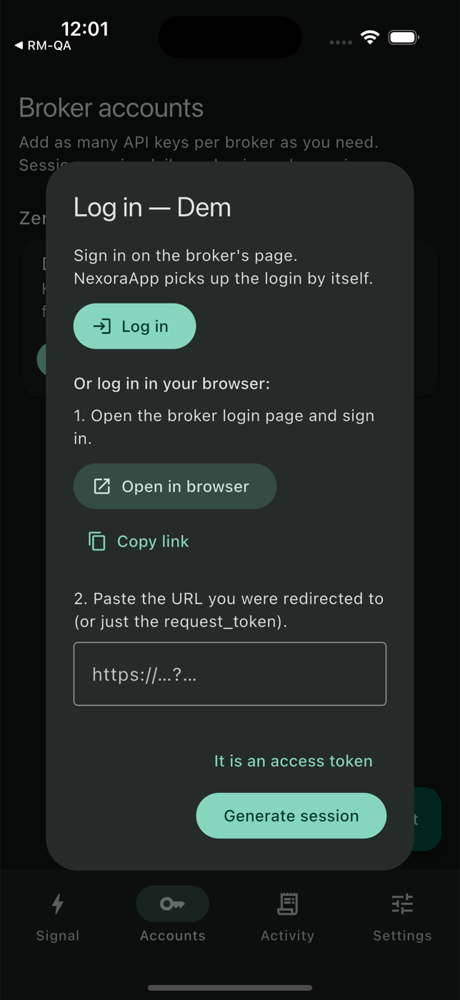
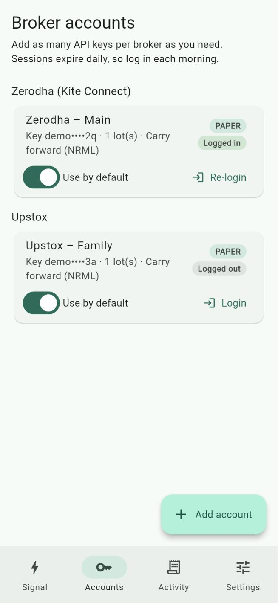
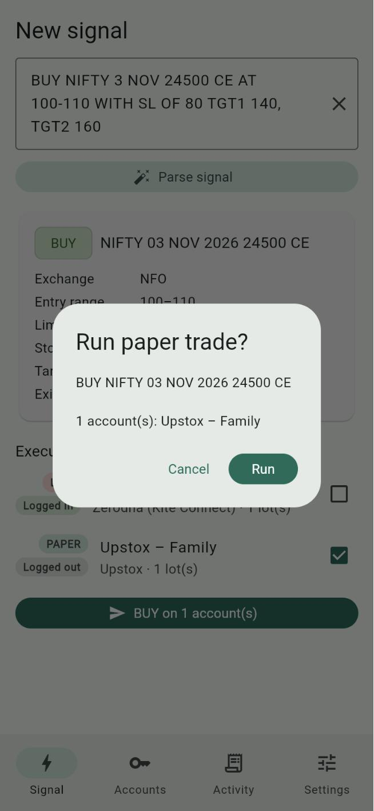
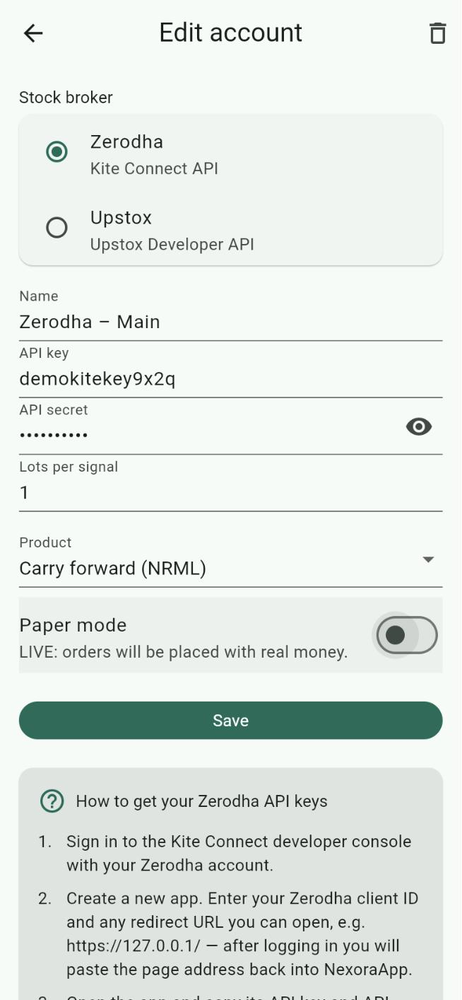
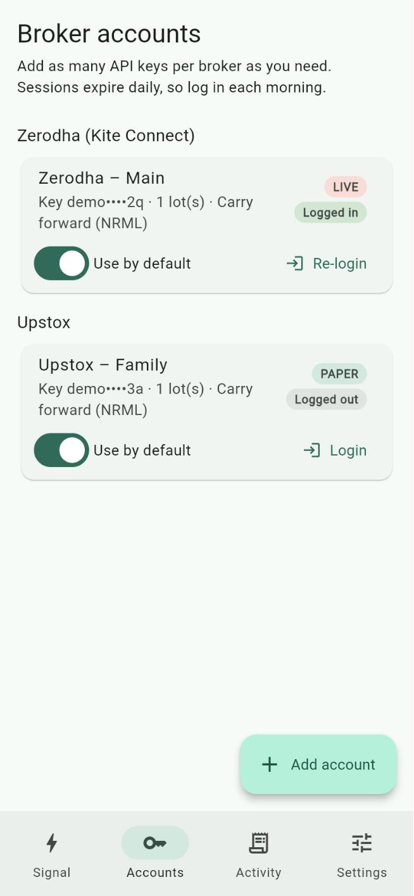
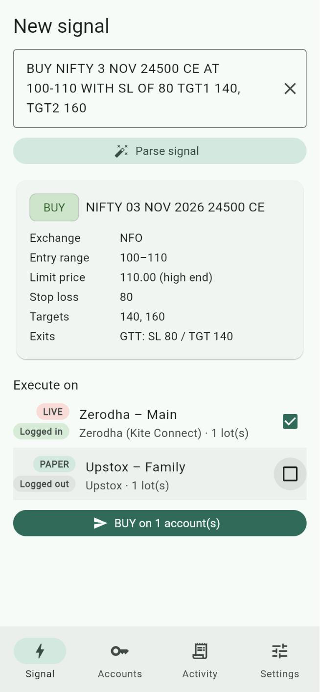
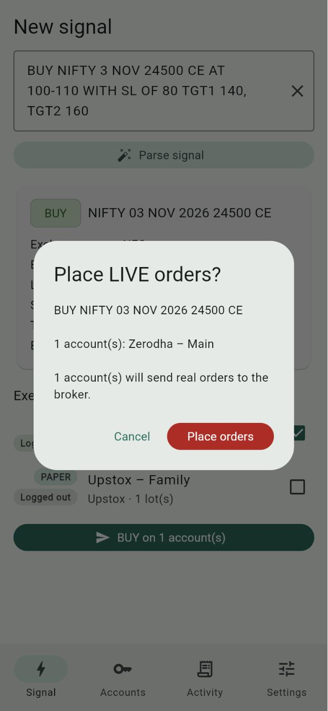

# Using NexoraApp with Zerodha (Kite Connect)

This guide takes you from nothing to a paper trade, and then to a real (live) order, using your Zerodha account. No programming knowledge is needed. Follow the parts in order.

| Part | What you do | Sends real orders? |
|---|---|---|
| [1. Get ready](#part-1-get-ready) | Check your Zerodha account and phone | No |
| [2. Create your Kite Connect app](#part-2-create-your-kite-connect-app) | Get an API key and secret from Zerodha | No |
| [3. Add the account in NexoraApp](#part-3-add-the-account-in-nexoraapp) | Type the key and secret into the app | No |
| [4. Log in (every trading day)](#part-4-log-in-every-trading-day) | Connect the app to Zerodha for the day | No |
| [5. Paper trade](#part-5-paper-trade) | Practise with a real signal; nothing is bought | No |
| [6. Live trade](#part-6-live-trade) | Place a real order | **Yes** |

> **Words used in this guide**
> - **API key / API secret**: a username and password that let NexoraApp talk to Zerodha for you. Zerodha gives them to you in Part 2. Never share the secret.
> - **Paper mode**: practice mode. NexoraApp shows what it *would* order but sends nothing to Zerodha.
> - **Live mode**: NexoraApp places real orders with real money.
> - **GTT (Good Till Triggered)**: an order that waits at Zerodha and fires only when the price reaches your stop loss or target.
> - **Static IP**: a fixed internet address. Zerodha accepts API orders only from an address you've registered (explained in Part 6).

---

## Part 1: Get ready

You need:

1. **A Zerodha trading account with F&O (futures and options) enabled.** Signals in NexoraApp are option trades. Check in the Kite app under **Profile → Segments**; if F&O isn't active, enable it from Zerodha's Console.
2. **NexoraApp on your Android phone or iPhone.** The phone app is recommended. The web version can only log in and practise, because browsers can't place orders with Zerodha directly.
3. **About ₹500 a month for the Kite Connect plan** (see Part 2 for why).
4. **Your Zerodha login details** (user ID, password and the 2-step code from your authenticator app). You'll use them on Zerodha's own page, never inside NexoraApp.

---

## Part 2: Create your Kite Connect app

Zerodha calls the API service "Kite Connect". Creating an "app" there gives you the API key and secret. You only do this once.

### 2.1 Sign up for a developer account

1. Open **[developers.kite.trade/signup](https://developers.kite.trade/signup)**.
2. Fill in:
   - **Kite Connect Email**: preferably the email on your Zerodha account.
   - **Your Name**, **Password** (twice), **Phone**, **State of Residence**.
3. Tick the terms checkbox and tap **Sign Up**. Verify your email if asked.

This is a separate login from your trading account. Write the password down somewhere safe.

### 2.2 Choose a plan

Zerodha offers two plans ([official FAQ](https://support.zerodha.com/category/trading-and-markets/general-kite/kite-api/articles/kite-connect-api-faqs)):

| Plan | Price | What it includes |
|---|---|---|
| **Personal** | Free | Placing orders, GTT, positions, holdings, funds. **No market data.** |
| **Connect** | ₹500 per month per app | Everything above **plus** live market data and historical data. |

**Choose Connect.** Before placing an order, NexoraApp downloads Zerodha's list of option contracts to find the exact contract and its lot size, and reads the latest price to set up the GTT correctly. These count as market data, which the free Personal plan doesn't include. On the Personal plan you'll most likely see *"Kite instruments download failed (403)"*.

Since October 2026, Zerodha gives paid users who pay at least ₹2,000 brokerage in a month credits that cover the next month's ₹500 fee.

Pay from the **Billing** page of the developer console.

### 2.3 Create the app

1. Sign in at **[developers.kite.trade](https://developers.kite.trade/)** and open **My Apps**.
2. Tap **Create New App** and fill in the form:

   | Field | What to enter |
   |---|---|
   | **App Name** | Anything, e.g. `NexoraApp` |
   | **Zerodha Client ID** | Your Zerodha user ID (e.g. `AB1234`) |
   | **Redirect URL** | Your server's address followed by `/broker-callback/zerodha`: `https://nexora-backend-jp.fly.dev/broker-callback/zerodha` for the default server (copy exactly). This is where Zerodha sends you after login; the server finishes it. |
   | **Postback URL** | Leave empty |
   | **Description** | Anything, e.g. `Personal option trading` |

3. If the form asks which plan or type the app is for, choose **Connect** (from 2.2). Save the app.
4. Open the app from **My Apps**. You'll see the **API key** and the **API secret** (you may need to tap to reveal it). Keep this page open for Part 3.

> Keep the API secret private. Anyone with your key, secret and a login code could act on your account. If you think it leaked, regenerate it on this page.

---

## Part 3: Add the account in NexoraApp

1. Open NexoraApp and go to the **Accounts** tab.
2. Tap **Add account**.
3. Under **Stock broker**, choose **Zerodha**.
4. Fill in the form:

   | Field | What to enter |
   |---|---|
   | **Name** | A label for you, e.g. `My Zerodha` |
   | **API key** | The API key from Part 2.3 |
   | **API secret** | The API secret from Part 2.3 (tap the eye icon to check it) |
   | **Lots per signal** | `1` while testing. The app buys this many lots per signal. |
   | **Product** | **Carry forward (NRML)** to hold overnight, or **Intraday (MIS)** to square off the same day |
   | **Paper mode** | **On**, and keep it on until Part 6 |

5. Tap **Save**.


The bottom of this screen shows **How to get your Zerodha API keys**, with the same steps and links, in case you need them later.

NexoraApp stores the key and secret in your phone's secure storage (Keychain on iPhone, encrypted Keystore storage on Android). They're never sent anywhere except Zerodha.

---

## Part 4: Log in (every trading day)

Zerodha logins via the API end every morning at about **6:00 AM IST**, so do this once each trading day before you use the app.

### On iPhone or Android (automatic)

1. On the **Accounts** tab, find your Zerodha card and tap **Login**.
2. Tap **Log in**. Zerodha's login page opens in Safari's in-app view (on Android, in a Chrome tab).

   

3. Log in with your Zerodha **user ID**, **password** and **2-step code**. The first time, Zerodha may ask you to **authorise** the app; allow it.
4. Zerodha sends you on to the server, which finishes the login and shows **Account linked**. Close that page (**Done** at the top left). NexoraApp notices by itself: the dialog closes, the card shows **Logged in**, and the button changes to **Re-login**.

   

Tap **Done** at the top left to close the login page.

### In another browser (web version, or as a fallback)

1. In the same dialog, tap **Open in browser** (on the web version it's called **Open login page**).
2. Log in. Zerodha sends the browser to the server, which finishes the login and shows **Account linked**.
3. Switch back to NexoraApp and switch tabs to refresh: the card shows **Logged in**.

**If it fails:** the `request_token` works only once and expires within a few minutes. Close the dialog, tap **Login** again and repeat a little faster.

---

## Part 5: Paper trade

Paper mode lets you check everything with real Zerodha data while nothing is bought or sold. Because you're logged in, NexoraApp looks up the real contract on Zerodha (so you can see it picked the right one), then stops before placing the order.

### 5.1 Pick a signal for a contract that exists

The signal must name an expiry date and strike that Zerodha actually lists, otherwise the app can't find the contract. To check:

1. In the Kite app, search the index, e.g. `NIFTY 24500 CE`.
2. Look at the expiry dates offered (for example `3 NOV`) and pick an upcoming one.
3. Use the same index, expiry, strike and CE/PE in your signal. Example:

   ```
   BUY NIFTY 3 NOV 24500 CE AT 100-110 WITH SL OF 80 TGT1 140, TGT2 160
   ```

   Index options on **NIFTY**, **BANKNIFTY**, **FINNIFTY** and **MIDCPNIFTY** trade on NSE (NFO). **SENSEX** and **BANKEX** trade on BSE (BFO). The app picks the exchange for you.

### 5.2 Run it

1. Go to the **Signal** tab, paste the signal and tap **Parse signal**.
2. Check the card: **BUY/SELL**, contract, **Entry range**, **Limit price**, **Stop loss**, **Targets** and **Exits**. If anything looks wrong, fix the signal text and parse again.
3. Under **Execute on**, tick your Zerodha account. It should show **PAPER** and **Logged in**.
4. Tap **BUY on 1 account(s)**. The app asks **Run paper trade?**. Tap **Run**.

   

### 5.3 Check the result

A results sheet opens (it's also saved in the **Activity** tab). For your Zerodha account, check:

- ✅ a green tick and **(paper)** after the account name;
- the **contract** is Zerodha's real trading symbol (it starts with the index and ends with the strike and CE/PE, e.g. `NIFTY…24500CE`), not just the signal text;
- the **quantity** is your lots × Zerodha's lot size for that index;
- **ENTRY (paper): PAPER-…** and, if exits are on, **SL … / TGT … (paper)**.


The screenshot above was taken while logged out, so it shows the signal text instead of Zerodha's symbol. When you're logged in you'll see the real symbol.

A red ❗ with a message means something needs fixing; see [Troubleshooting](#troubleshooting). Repeat paper trades until you're comfortable.

---

## Part 6: Live trade

> ⚠️ **Live mode places real orders with real money.** Losses are possible. NexoraApp's live order code follows Zerodha's published documentation but hasn't yet been run against a real account, so start with **1 lot** and keep the Kite app open alongside.

### 6.1 Register a static IP (one-time)

From **1 April 2025**, Zerodha accepts API orders only from a **static IP** registered on your developer account ([Zerodha FAQ](https://support.zerodha.com/category/trading-and-markets/general-kite/kite-api/articles/kite-connect-api-faqs)). Logging in and paper trading don't need it.

Your phone's internet address normally changes (mobile data, home Wi-Fi), so you need one of these:

- **A static IP from your home broadband provider.** Many providers sell it as an add-on; call yours and ask for a "static public IP". Then trade only while your phone is on that Wi-Fi.
- **A VPN service with a dedicated (static) IP.** Install its app on your phone and switch it on whenever you trade. Zerodha accepts VPN addresses.

Then:

1. Connect your phone the way you'll trade (home Wi-Fi or VPN on).
2. Open **[api.ipify.org](https://api.ipify.org)** in the phone's browser. The number shown (e.g. `203.0.113.25`) is your current public IP.
3. Sign in at **[developers.kite.trade/profile](https://developers.kite.trade/profile)** and enter it as the **Primary IP**. You can add a second one as **Secondary IP**.
4. Save. Zerodha allows **one change per week**, so double-check the number.

Zerodha's rules say the static IP may be shared only with immediate family.

### 6.2 Make sure the account can trade

- Enough **funds** in Zerodha for 1 lot at the limit price (check **Funds** in Kite).
- F&O enabled (Part 1).
- Logged in today (Part 4).

### 6.3 Switch the account to live

1. **Accounts** → tap your Zerodha card.
2. Check **Lots per signal** is `1` and **Product** is what you want.
3. Turn **Paper mode** off. The text changes to *"LIVE: orders will be placed with real money."*

   

4. Tap **Save**. The card now shows a red **LIVE** badge.

   

### 6.4 Check Settings

On the **Settings** tab:

- **Limit price within the entry range**: for `AT 100-110`, **Low end** = 100, **Middle** = 105, **High end** = 110. A higher price fills more easily but costs more.
- **Exit orders**: **Entry + stop loss & target (GTT)** places a GTT with your stop loss and target straight after the entry. **Entry order only** places just the buy order.
- **Target used for the GTT exit**: which target (TGT1/2/3) the GTT uses.

### 6.5 Place the order

1. Make sure your phone is on the static IP (Wi-Fi or VPN from 6.1).
2. **Signal** tab → paste the signal → **Parse signal** → check the card.
3. Tick **only** your live Zerodha account.

   

4. Tap **BUY on 1 account(s)**. The app now asks **Place LIVE orders?** and says how many accounts will send real orders. Read it carefully, then tap **Place orders**, or **Cancel** to stop.

   

### 6.6 Check it in Kite

Open the Kite app (or [kite.zerodha.com](https://kite.zerodha.com)) → **Orders**:

- **Open / Executed**: a **LIMIT** buy order for your contract at the limit price. It stays open until the price reaches it.
- **GTT**: if exits are on, a GTT with **two legs (OCO)**, one at your stop loss and one at your target. When one fires, the other is cancelled. The stop-loss leg uses a limit price about 5% beyond the trigger so it still fills in a fast market.

NexoraApp shows the Zerodha order IDs in the result, and in the **Activity** tab.

### 6.7 Change or cancel

NexoraApp only places orders. To cancel an open order, change or delete a GTT, or exit a position, use the **Kite app**. If you cancel an unfilled entry, also delete its GTT so it can't fire later.

To go back to practice, edit the account and turn **Paper mode** on again.

---

## Daily checklist

1. Phone on your static IP (only needed for live).
2. NexoraApp → **Accounts** → **Login** / **Re-login** → **Log in** → sign in (NexoraApp finishes the login by itself).
3. **Signal** → paste → **Parse signal** → check → tick accounts → confirm.
4. Check orders and GTTs in Kite.

---

## Troubleshooting

| What you see | What it means / what to do |
|---|---|
| *Session expired — log in to … first* | You haven't logged in today. Do Part 4. |
| Error after **Generate session** | The login code was already used or has expired (it lasts only a few minutes), or the API secret is wrong. Log in again; check the secret in Part 2.3. |
| *Kite instruments download failed (403). Is the session valid?* | Today's login has expired, **or** your app is on the free **Personal** plan, which has no market data. Log in again; if it still fails, switch to the **Connect** plan (Part 2.2). |
| *No Kite contract found for …* | That expiry or strike isn't listed. Check it in Kite (Part 5.1) and fix the signal. |
| `TokenException` / *Incorrect api_key or access_token* | Session expired, or you logged in to the same app somewhere else (a new login cancels the old one). Log in again. |
| Order rejected mentioning **IP** | The order didn't come from your registered static IP. Check [api.ipify.org](https://api.ipify.org) on the phone matches [developers.kite.trade/profile](https://developers.kite.trade/profile). |
| Order rejected for **margin/funds** | Not enough money in Zerodha for the order. Add funds or reduce lots. |
| Web app: *Order placement is disabled on this proxy* | Expected. The web version can't place orders. Use the phone app. |

More help: [Kite Connect documentation](https://kite.trade/docs/connect/v3/) and the [Kite Connect forum](https://kite.trade/forum/discussions). Zerodha doesn't handle API questions on its phone support.
